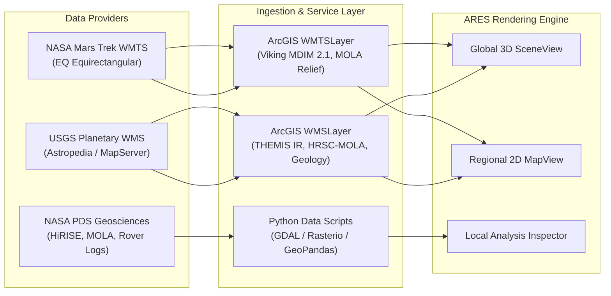

# ARES — System Architecture & Technical Specification

## 1. Executive Summary
ARES (Advanced Reconnaissance and Exploration System) is a map-first planetary exploration platform built with React, TypeScript, Vite, Tailwind CSS, and the ArcGIS Maps SDK for JavaScript (`@arcgis/core`).

---

## 2. High-Level Architecture

```
┌────────────────────────────────────────────────────────────────────────┐
│                        ARES Client Application                         │
│                                                                        │
│  ┌──────────────────────────────────────────────────────────────────┐  │
│  │                    Zustand Application Store                     │  │
│  │  - Camera State (Lon, Lat, Altitude, Heading, Tilt)              │  │
│  │  - Exploration Mode: GLOBAL_3D | REGIONAL_2D | LOCAL_ANALYSIS    │  │
│  │  - Active Layer Stack & Opacities                                │  │
│  │  - Measurement & Route Tool State                                │  │
│  └──────────────────────────────────┬───────────────────────────────┘  │
│                                     │                                  │
│  ┌──────────────────────────────────┴───────────────────────────────┐  │
│  │                      Map Viewport Hierarchy                      │  │
│  │  ┌────────────────────────────────────────────────────────────┐  │  │
│  │  │ Full-Bleed 3D SceneView (Mars Ellipsoid WKID 104905)       │  │  │
│  │  │ - 3D Mars Elevation Mesh (MOLA / HRSC)                     │  │  │
│  │  │ - Surface Imagery (Viking MDIM 2.1, THEMIS IR, CTX Mosaics)│  │  │
│  │  └────────────────────────────────────────────────────────────┘  │  │
│  │  ┌────────────────────────────────────────────────────────────┐  │  │
│  │  │ Synchronized 2D MapView (Regional Cartography)             │  │  │
│  │  │ - Equirectangular / Simple Cylindrical Mars projection     │  │  │
│  │  └────────────────────────────────────────────────────────────┘  │  │
│  └──────────────────────────────────┬───────────────────────────────┘  │
│                                     │                                  │
│  ┌──────────────────────────────────┴───────────────────────────────┐  │
│  │                  Non-Intrusive Floating HUD                      │  │
│  │  - Top: Header Bar & Mode Switcher (Global 3D / Regional 2D)     │  │
│  │  - Bottom: Live Telemetry Strip (Lon, Lat, Elevation, Scale)     │  │
│  │  - Left: Layer Manager & Scientific Provenance Drawer            │  │
│  │  - Right: Measurement Tools / Rover Traverses / Route Planner    │  │
│  └──────────────────────────────────────────────────────────────────┘  │
└────────────────────────────────────────────────────────────────────────┘
```

---

## 3. Planetary Geodetic Parameters

ARES uses real IAU Martian geodetic definitions:
- **Spatial Reference Name:** `GCS_Mars_2000`
- **Well-Known ID (WKID):** `104905` (Mars 2000 Sphere) / `104971` (Mars 2000 Spheroid)
- **Equatorial Radius ($a$):** $3,396,190.0\text{ m}$
- **Polar Radius ($b$):** $3,376,200.0\text{ m}$
- **Flattening ($f$):** $0.005886$

---

## 4. Scientific Data Ingestion Architecture



---

## 5. Security, Licensing & Availability Policies
- All client-side requests to NASA Mars Trek and USGS are standard OGC WMTS/WMS requests requiring no proprietary credentials.
- Automatic retry and graceful degradation: if an external tile service fails, the map remains interactive and informs the user with an in-HUD warning pill.
- CORS policy: Verified that NASA Trek and USGS serve tiles with `Access-Control-Allow-Origin: *`.

