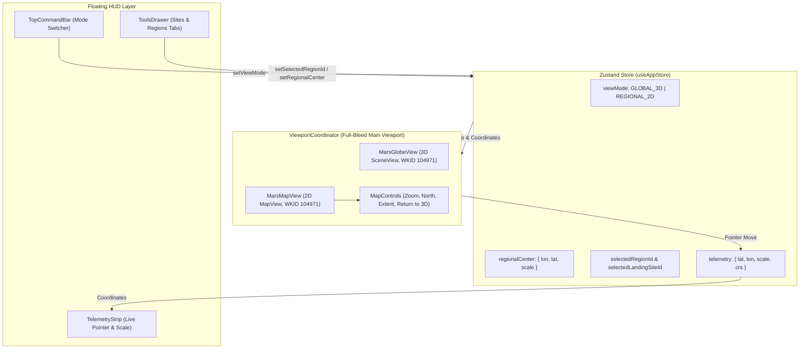

# Phase 04: 2D Regional Exploration Design Specification

**Status:** Approved
**Date:** 2026-11-02
**Author:** Antigravity / ARES Core Team
**Approach Selected:** Approach A (Dual-Viewport Coordinator with Seamless Crossfade & State Mirroring)

---

## 1. Executive Summary

Phase 04 bridges the global 3D Mars globe (`MarsGlobeView` using `@arcgis/core/views/SceneView`) with the regional 2D cartographic map (`MarsMapView` using `@arcgis/core/views/MapView`). It provides planetary geologists and mission operators with an unconstrained top-down cartographic viewport for inspecting high-resolution Martian terrain, scientific nomenclature, landing sites, and exploration regions without 3D perspective distortion or artificial image stretching.

---

## 2. Architecture & Component Interaction

---

## 3. Detailed Specifications

### 3.1 Martian Spatial Reference & Coordinate Standards
- **Coordinate Reference System:** `GCS_Mars_2000` (`WKID 104971` / `104905`).
- **Datum:** Mars 2000 datum ($a = 3,396,190\text{ m}$).
- **Longitude System:** East-positive, $[0^\circ, 360^\circ]$ or $[-180^\circ, +180^\circ]$ mapped consistently.
- Both 3D `SceneView` and 2D `MapView` consume the identical spatial reference configuration to prevent geographic re-projection offsets.

### 3.2 Regional Bookmarks (`marsRegions.ts`)
Authoritative scientific regions with verified bounding boxes, center coordinates, and exploration relevance:
1. **Jezero Crater Delta** ($18.38^\circ\text{ N}, 77.45^\circ\text{ E}$): Ancient lacustrine delta and Mars 2020 Perseverance exploration corridor.
2. **Gale Crater & Mount Sharp** ($-4.59^\circ\text{ N}, 137.44^\circ\text{ E}$): Layered sedimentary sulfate units explored by Curiosity.
3. **Olympus Mons Caldera** ($18.65^\circ\text{ N}, 226.20^\circ\text{ E}$): Shield volcano summit caldera ($21.9\text{ km}$ above datum).
4. **Valles Marineris (Candor Chasma)** ($-6.53^\circ\text{ N}, 284.10^\circ\text{ E}$): Central rift canyon with layered bedrock exposure.
5. **Elysium Planitia** ($4.50^\circ\text{ N}, 135.62^\circ\text{ E}$): Smooth volcanic plains and InSight geophysics station.

### 3.3 2D Regional Map (`MarsMapView.tsx`)
- Constructed with `@arcgis/core/views/MapView`.
- Primary basemap: Mars MDIM 2.1 Color Mosaic TileLayer (`astro.arcgis.com`).
- Shaded Relief: MColorDEM shaded relief ground layer.
- Overlays: Landing sites graphics layer and IAU nomenclature labels.
- Controls (`MapControls.tsx`):
  - Zoom in / Zoom out.
  - Reset North (`rotation: 0`).
  - Reset Extent (to current region bounding box).
  - "Return to Global 3D" pill button.
- Performance & Lifecycle:
  - Headless test environment guard (`typeof window.WebGLRenderingContext !== 'undefined'`).
  - Clean event cleanup and view destroy on component unmount.

### 3.4 Continuous Viewport Coordinator (`ViewportCoordinator.tsx`)
- Maintains persistent DOM containers for both `MarsGlobeView` and `MarsMapView`.
- Smooth CSS crossfade (`opacity-100 pointer-events-auto` vs `opacity-0 pointer-events-none`).
- Syncs coordinates between views: entering 2D regional mode centers the map on `regionalCenter` or active site coordinates.
- Supports clicking "Explore in 2D Map" from 3D globe site selection.

---

## 4. Test Strategy
1. **Unit Tests:**
   - `marsRegions.test.ts`: Validate bounding boxes, coordinate formats, and region identifiers.
   - `useAppStore.test.ts`: Verify `regionalCenter`, `selectedRegionId`, and navigation state actions.
   - `MarsMapView.test.tsx`: Test container rendering, headless WebGL fallback, and 2D map controls.
   - `ViewportCoordinator.test.tsx`: Test mode-based crossfade rendering and state passing.
   - `ToolsDrawer.test.tsx`: Test Regions tab interaction and "Explore in 2D" button.
2. **Integration Verification:**
   - Vitest suite run (all tests pass).
   - TypeScript build check (`npm run build`).
   - Browser verification via Playwright if needed.
