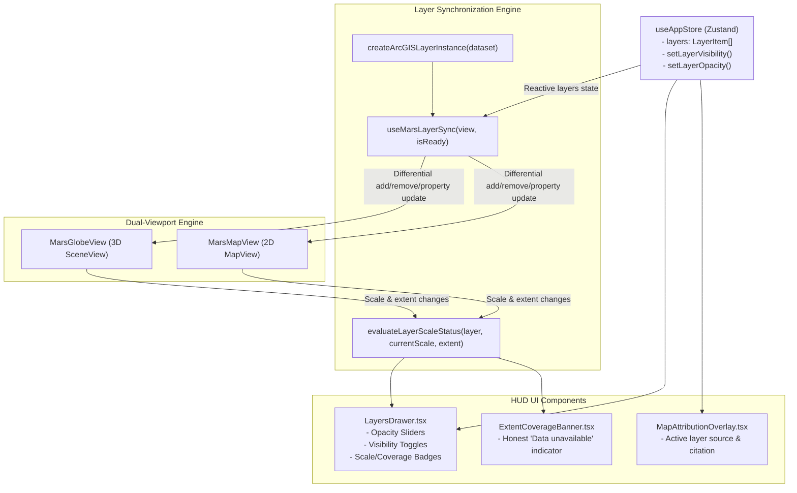

# Phase 05 — Multi-Resolution Imagery and Map Layers Design Specification

## 1. Overview & Objective
Phase 05 establishes the multi-resolution Mars imagery and scientific layer-management subsystem for ARES (Advanced Reconnaissance and Exploration System). It connects the global 3D Mars globe (`SceneView`) and 2D regional map (`MapView`) to an authoritative ladder of planetary datasets, providing smooth progressive loading, opacity controls, extent/scale evaluation, and honest coverage communication.

---

## 2. Planetary Invariants & Technical Constraints
1. **Planetary Coordinate System**:
   - Datum: `D_Mars_2000` (`WKID 104971` / `104905`).
   - Spheroid Equatorial Radius: $a = 3,396,190\text{ m}$.
   - Earth coordinate systems (WGS84, EPSG:3857) are strictly banned.
2. **Scientific Integrity**:
   - All layers must reference authentic, verifiable planetary missions and datasets (Viking MDIM, MOLA-HRSC, MRO CTX, HiRISE, USGS Quad series).
   - Datasets are labeled with standard classifications: `OBSERVED`, `DERIVED`, `MODELED`, or `SIMULATED`.
3. **No Broken States or Faked Coverage**:
   - If a layer has localized or scale-bounded coverage (e.g. HiRISE DTM footprints or CTX regional mosaics), the system must never stretch low-resolution imagery or fake high-resolution tiles.
   - The UI must display an honest indicator when an extent or scale lacks coverage.
4. **Non-Intrusive HUD**:
   - Map viewport remains the dominant interface element.
   - Layer controls, opacity sliders, attribution chips, and status badges float as collapsible HUD components.

---

## 3. Imagery & Layer Hierarchy (Multi-Resolution Ladder)

| Tier | Identifier | Dataset Name | Resolution | Format | Protocol / Provider | Scale Range (`minScale` - `maxScale`) |
|---|---|---|---|---|---|---|
| **L0** | `mars-viking-mdim21` | Viking MDIM 2.1 Color Mosaic | 232 m/px | `TILE_SERVER` | ArcGIS MapServer (USGS / Esri) | Global (no scale limits) |
| **L1** | `mars-hrsc-mola-blend` | HRSC–MOLA Blended DEM | 200 m/px | `IMAGE_SERVER` | ArcGIS ImageServer / LERC | Global (3D ground surface) |
| **L2** | `mars-ctx-mosaic` | MRO CTX Global Mosaic | 5.0–6.0 m/px | `WMTS` / `TILE_SERVER` | NASA Mars Trek WMTS / XYZ | $1:2,500,000 \to 1:25,000$ |
| **L3** | `mars-hirise-footprints` | HiRISE DTM Footprint Index | 0.25–1.0 m/px | `GEOJSON` | Vector polygon outlines | $1:10,000,000 \to 1:1,000$ |
| **L3+** | `mars-hirise-jezero-dtm` | HiRISE Targeted DTM (Jezero Delta) | 0.25 m/px | `TILE_SERVER` | NASA Mars Trek WMTS Localized | $1:100,000 \to 1:1,000$ (Extent bounded) |
| **T1** | `mars-geologic-quads` | USGS Geologic Map of Mars | 1:5,000,000 | `WMS` | USGS Planetary WMS | $1:25,000,000 \to 1:500,000$ |
| **T2** | `mars-nomenclature` | IAU Planetary Gazetteer | Vector Points | `GEOJSON` | Planetary Nomenclature GeoJSON | Global ($1:20,000,000 \to 1:5,000$) |

---

## 4. Component & Service Architecture



### 4.1 Layer Synchronization Engine (`useMarsLayerSync.ts`)
- Manages an internal `Map<string, Layer>` mapping layer IDs to live `@arcgis/core` instances.
- On store changes:
  - If a layer is toggled visible and not yet in `view.map.layers`, asynchronously instantiate it via `createArcGISLayerInstance(dataset)` and insert it at the appropriate z-index.
  - If a layer is already in `view.map.layers`, mutate its `.visible` property directly.
  - If a layer's opacity changes, mutate its `.opacity` property directly without reconstructing the layer.
  - If a layer is toggled off, set `visible = false` (or remove if memory management threshold requires eviction).
  - Handles cleanup and memory deallocation on view unmount.

### 4.2 Scale & Extent Evaluation Service (`layerResolutionService.ts`)
- Pure utility function:
  ```typescript
  export type LayerScaleStatus = 'ACTIVE' | 'SCALE_INACTIVE' | 'OUT_OF_EXTENT' | 'OFFLINE';

  export function evaluateLayerStatus(
    layer: DatasetEntry,
    currentScale: number,
    currentExtent?: { minLon: number; maxLon: number; minLat: number; maxLat: number }
  ): LayerScaleStatus;
  ```
- Determines if the current view zoom is capable of resolving the layer's imagery or if the layer is out of bounds.

### 4.3 Viewport Attribution & Scale Banner
- `MapAttributionOverlay.tsx`: Displays floating bottom-left attribution chip with the active surface imagery dataset, mission provider, and spatial resolution.
- `ExtentCoverageBanner.tsx`: When an active localized layer (e.g. HiRISE DTM) is outside the current viewport extent or above its `minScale`, non-intrusively communicates:
  *"HiRISE Sub-Meter DTM: Targeted coverage active at Jezero Crater Delta (zoom in below 1:100,000)"*.

---

## 5. Testing Plan
1. **Unit Tests**:
   - `layerResolutionService.test.ts`: Validate scale boundary checks, extent containment logic, and status calculation.
   - `layerService.test.ts`: Verify instantiation of NASA Trek WMTS (`WebTileLayer`/`WMTSLayer`), USGS WMS, and GeoJSON layers.
   - `datasetRegistry.test.ts`: Verify all registered layers have required scale thresholds, citations, and spatial references.
2. **Integration Tests**:
   - `MarsGlobeView.test.tsx`: Test that layer visibility and opacity reflect correctly in 3D SceneView.
   - `MarsMapView.test.tsx`: Test that layer visibility and opacity reflect correctly in 2D MapView.
   - `LayersDrawer.test.tsx`: Test category filtering, visibility toggle, opacity adjustment, and status chip rendering.
   - `MapAttributionOverlay.test.tsx`: Test dynamic attribution update based on active base layer.

