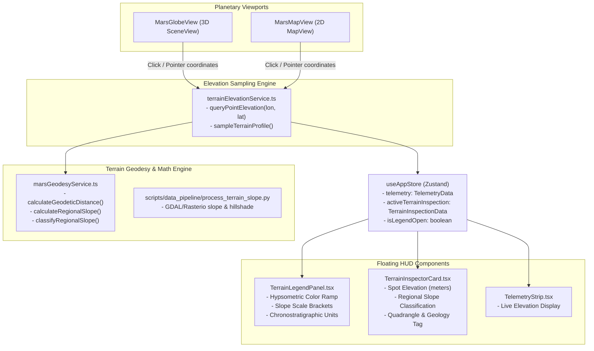

# Phase 06 — Terrain Intelligence and Analysis Design Specification

## 1. Overview & Objective
Phase 06 implements the ARES Terrain Intelligence and Analysis subsystem. It converts authentic Martian topographic, elevation, and geological datasets into interactive visual layers, provides point elevation inspection, calculates geodetically sound regional slope, and delivers scientific legends and units across both 3D (`SceneView`) and 2D (`MapView`) planetary viewports.

---

## 2. Scientific & Planetary Geodetic Invariants
1. **Planetary Coordinate System**:
   - Strictly Mars 2000 datum (`D_Mars_2000`, `WKID 104971` / `104905`).
   - Mean equatorial radius: $a = 3,396,190\text{ m}$.
   - Earth coordinate reference systems (EPSG:3857, WGS84) are strictly prohibited.
2. **Scientific Data Integrity**:
   - Datum Elevation reference: Mars MOLA areoid ($0\text{ m}$ elevation datum defined by mean equatorial radius $a = 3,396,190\text{ m}$ and zero-potential gravity field).
   - Datasets used:
     - Elevation: HRSC–MOLA Blended DEM at 200m/pixel (Fergason et al. 2018).
     - Shaded Relief: MColorDEM Shaded Relief & Colorized DEM (USGS / Esri).
     - Geology: USGS Geologic Map of Mars (Tanaka et al. 2014, SIM 3292).
     - HiRISE: Sub-meter DTMs (McEwen et al. 2007, NASA PDS).
3. **Slope Classification Discipline (Non-Negotiable)**:
   - Global and regional elevation-derived slope MUST be labeled and described as **Regional Terrain Slope (Derived)**.
   - **Never** fabricate or imply rover-scale obstacle detection from 200m DEMs.
   - Any slope display must show the disclaimer: *"Regional terrain gradient derived from 200m DEM. Not suitable for rover-scale obstacle navigation."*
4. **Geodetic Distance Math**:
   - Accounts for Martian latitude ground distance distortion:
     $$\Delta x = \frac{\pi \cdot 3,396,190 \cdot \cos(\phi)}{180} \cdot \Delta \lambda$$
     $$\Delta y = \frac{\pi \cdot 3,396,190}{180} \cdot \Delta \phi$$
     $$\text{Slope} = \arctan\left(\frac{\Delta z}{\sqrt{\Delta x^2 + \Delta y^2}}\right)$$

---

## 3. Architecture & Subsystems



---

## 4. Component Details & Data Contracts

### 4.1 Geodesy & Math Engine (`marsGeodesyService.ts`)
```typescript
export interface TerrainSlopeClassification {
  angleDegrees: number;
  category: 'FLAT' | 'GENTLE' | 'MODERATE' | 'STEEP' | 'PRECIPITOUS';
  description: string;
  disclaimer: string;
}

export function calculateMarsGroundDistance(
  lon1: number, lat1: number,
  lon2: number, lat2: number
): number;

export function classifyRegionalSlope(angleDegrees: number): TerrainSlopeClassification;
```

### 4.2 Elevation Sampling Service (`terrainElevationService.ts`)
```typescript
export interface TerrainInspectionData {
  longitude: number;
  latitude: number;
  elevationMeters: number;
  regionalSlopeDegrees?: number;
  slopeCategory?: string;
  quadrangleName?: string;
  geologicalPeriod?: 'Amazonian' | 'Hesperian' | 'Noachian' | 'Undivided';
  classification: 'OBSERVED' | 'DERIVED' | 'INTERPRETED';
}

export async function queryPointElevation(
  longitude: number,
  latitude: number,
  elevationLayer?: any
): Promise<number>;
```

### 4.3 Floating HUD Terrain Legend Panel (`TerrainLegendPanel.tsx`)
- Collapsible glassmorphism panel in the lower-right viewport.
- Three tabbed or stacked sections:
  1. **Elevation (Topography)**: Color ramp from $-8,200\text{ m}$ (deep purple/blue) through $0\text{ m}$ (greenish/yellow datum) to $+21,229\text{ m}$ (bright white/red peak).
  2. **Regional Slope**: $0^\circ\text{–}5^\circ$ (Flat plains), $5^\circ\text{–}15^\circ$ (Rolling), $15^\circ\text{–}25^\circ$ (Steep), $>25^\circ$ (Chasmata / Escarpments).
  3. **Martian Chronostratigraphy**:
     - 🟠 **Amazonian**: Youngest volcanic/eolian surfaces ($<3.0\text{ Ga}$).
     - 🟤 **Hesperian**: Intermediate volcanic plains & outflow channels ($3.0\text{–}3.7\text{ Ga}$).
     - 🔴 **Noachian**: Ancient cratered highlands & phyllosilicate-rich valley networks ($>3.7\text{ Ga}$).

### 4.4 Floating Terrain Inspector Card (`TerrainInspectorCard.tsx`)
- When a user clicks on the Mars surface in 3D or 2D:
  - Displays pinned target pin on surface.
  - Shows floating card with spot elevation, coordinates, slope classification with warning caveat, quadrangle name, and scientific classification badge (**DERIVED**).
  - Close button to dismiss.

---

## 5. Testing Plan
- `marsGeodesyService.test.ts`: Test Martian latitude-dependent ground distances, slope calculations, and classification brackets.
- `terrainElevationService.test.ts`: Test elevation query formatting, caching, and fallback handling.
- `TerrainLegendPanel.test.tsx`: Test rendering of color ramps, units, and tab switching.
- `TerrainInspectorCard.test.tsx`: Test display of spot elevation, scientific caveats, and dismissal.
- `MarsGlobeView.test.tsx` & `MarsMapView.test.tsx`: Test surface click inspection event wiring and live telemetry elevation updates.

